# MDD Connections

## Path Tree

```
Game
├── Campaign     03-campaign-map        complete
├── Characters   06-talking-characters  complete
├── Engine       01-game-core           complete
├── Hangar       02-hangar-economy      complete
├── Honours
│   ├── Base      30-hangar-base         complete
│   ├── Medals    24-medals-core         complete
│   ├── Ceremony  25-medal-ceremony      complete
│   ├── Locker    31-locker-uniform      complete
│   └── PictureWall 32-picture-wall      complete
├── Ladder
│   ├── Rating    26-pilot-rating        complete
│   ├── Service   27-online-ladder       complete
│   └── Screen    28-ladder-screen       complete
├── Languages    07-i18n                complete
├── Look
│   └── Retro     20-retro-look          complete
├── Minigames
│   ├── Core      10-minigames-core      complete
│   ├── Evasion   16-missile-evasion     complete
│   ├── Flyby     13-tower-flyby         complete
│   ├── Formation 14-formation-flying    complete
│   ├── Landing   18-carrier-landing     complete
│   ├── Motorbike 22-motorbike-vs-jet    complete
│   ├── Piano     23-piano-bar           complete
│   ├── Hub       11-base-hub            complete
│   ├── People    17-people-kit          complete
│   ├── Pushups   12-pushup-challenge    complete
│   ├── Refuel    15-air-refuelling      complete
│   ├── Volleyball 21-beach-volleyball   complete
│   └── Tactics   19-dogfight-tactics    complete
├── Mission      05-mission-combat      complete
├── PaintJobs    09-paint-jobs          complete
├── Pilots       08-pilot-profiles      complete
└── Takeoff      04-carrier-takeoff     complete
Meta
└── Schema       00-frontmatter-spec    complete
```

## Dependency Graph

```mermaid
graph TD
  core[01-game-core]:::complete
  hangar[02-hangar-economy]:::complete
  map[03-campaign-map]:::complete
  takeoff[04-carrier-takeoff]:::complete
  mission[05-mission-combat]:::complete
  chars[06-talking-characters]:::complete
  i18n[07-i18n]:::complete
  pilots[08-pilot-profiles]:::complete
  paint[09-paint-jobs]:::complete
  mgcore[10-minigames-core]:::complete
  hub[11-base-hub]:::complete
  pushups[12-pushup-challenge]:::complete
  flyby[13-tower-flyby]:::complete
  formation[14-formation-flying]:::complete
  refuel[15-air-refuelling]:::complete
  evasion[16-missile-evasion]:::complete
  people[17-people-kit]:::complete
  landing[18-carrier-landing]:::complete
  tactics[19-dogfight-tactics]:::complete
  retro[20-retro-look]:::complete
  volley[21-beach-volleyball]:::complete
  moto[22-motorbike-vs-jet]:::complete
  piano[23-piano-bar]:::complete
  medals[24-medals-core]:::complete
  ceremony[25-medal-ceremony]:::complete
  rating[26-pilot-rating]:::complete
  ladder[27-online-ladder]:::complete
  ladderui[28-ladder-screen]:::complete
  hbase[30-hangar-base]:::complete
  locker[31-locker-uniform]:::complete
  wall[32-picture-wall]:::complete
  locker --> medals
  locker --> ceremony
  locker --> rating
  locker --> retro
  locker --> i18n
  wall --> medals
  wall --> map
  wall --> paint
  wall --> retro
  wall --> i18n
  wall --> locker
  hangar --> core
  map --> core
  map --> hangar
  takeoff --> core
  takeoff --> hangar
  takeoff --> map
  mission --> core
  mission --> hangar
  mission --> map
  mission --> takeoff
  chars --> core
  chars --> i18n
  chars --> pilots
  i18n --> core
  pilots --> core
  pilots --> i18n
  paint --> hangar
  paint --> map
  paint --> chars
  paint --> i18n
  mgcore --> core
  medals --> pilots
  medals --> map
  medals --> mgcore
  ceremony --> medals
  ceremony --> chars
  ceremony --> people
  ceremony --> retro
  rating --> map
  rating --> mgcore
  ladder --> rating
  ladder --> pilots
  ladderui --> ladder
  ladderui --> rating
  ladderui --> pilots
  mgcore --> map
  mgcore --> i18n
  mgcore --> pilots
  hub --> mgcore
  hub --> map
  hub --> chars
  pushups --> mgcore
  flyby --> mgcore
  formation --> mgcore
  refuel --> mgcore
  evasion --> mgcore
  pushups --> people
  landing --> mgcore
  tactics --> mgcore
  tactics --> people
  retro --> chars
  retro --> pilots
  retro --> people
  retro --> i18n
  volley --> mgcore
  volley --> people
  moto --> mgcore
  moto --> people
  piano --> mgcore
  piano --> people
  hbase --> hub
  hbase --> retro
  hbase --> people
  hbase --> paint
  hbase --> chars
  hbase --> i18n
  classDef complete fill:#2f9e5a,color:#fff
  classDef in_progress fill:#d39b1f,color:#000
  classDef draft fill:#5c6f82,color:#fff
  classDef deprecated fill:#333,color:#aaa
```



## Source File Overlap

(none — every source file belongs to exactly one feature doc)

## Warnings

(none)
