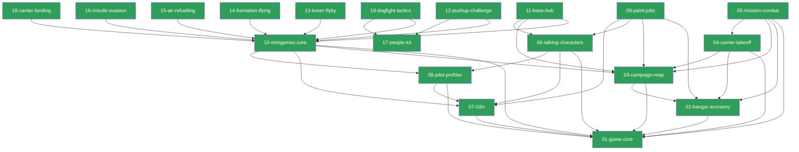

# MDD Connections

## Path Tree

```
Game
├── Campaign     03-campaign-map        complete
├── Characters   06-talking-characters  complete
├── Engine       01-game-core           complete
├── Hangar       02-hangar-economy      complete
├── Languages    07-i18n                complete
├── Minigames
│   ├── Core      10-minigames-core      complete
│   ├── Evasion   16-missile-evasion     complete
│   ├── Flyby     13-tower-flyby         complete
│   ├── Formation 14-formation-flying    complete
│   ├── Landing   18-carrier-landing     complete
│   ├── Hub       11-base-hub            complete
│   ├── People    17-people-kit          complete
│   ├── Pushups   12-pushup-challenge    complete
│   ├── Refuel    15-air-refuelling      complete
│   └── Tactics   19-dogfight-tactics    complete
├── Mission      05-mission-combat      complete
├── PaintJobs    09-paint-jobs          complete
├── Pilots       08-pilot-profiles      complete
└── Takeoff      04-carrier-takeoff     complete
Meta
└── Schema       00-frontmatter-spec    complete
```

## Dependency Graph



## Source File Overlap

(none — every source file belongs to exactly one feature doc)

## Warnings

(none)
