# MDD Connections

## Path Tree

```
Game
├── Campaign   03-campaign-map (complete)
│   ├── Celebration   64-world-celebrations (complete)
│   ├── Challenge Level   38-challenge-level (complete)
│   ├── FifthMap   65-fifth-map (complete), 70-map-five-campaign (complete)
│   ├── FourthMap   56-fourth-map (complete), 58-map-four-campaign (complete)
│   ├── Mission Score   39-mission-score (complete)
│   ├── Second Map   35-second-map (complete)
│   ├── Third Map   48-third-map (complete)
│   └── World Order   74-world-order (complete)
├── Characters   06-talking-characters (complete)
├── Engine   01-game-core (complete)
├── Hangar   02-hangar-economy (complete)
│   ├── Bofors HE Gun   46-bofors-he-gun (complete)
│   ├── Deep Arsenal   43-deep-arsenal (complete)
│   ├── Double Firepower   37-double-firepower (complete)
│   ├── Helicopter Fleet   51-heli-fleet (complete)
│   ├── Helicopter Kit   49-helicopter-kit (complete)
│   ├── Incendiary Ammo   45-incendiary-ammo (complete)
│   ├── New Jets   36-new-jets (complete)
│   ├── PointDefence   60-point-defence (complete)
│   ├── Shipyard   55-shipyard (complete)
│   ├── SpaceArsenal   57-space-arsenal (complete)
│   ├── Spacecraft   54-spacecraft (complete)
│   ├── Sub Fleet   69-sub-fleet (complete)
│   └── Sub Kit   66-sub-kit (complete)
├── Honours
│   ├── Base   30-hangar-base (complete), 63-hangar-tv (complete), 73-home-docks (complete)
│   │   └── Chalkboard   40-chalkboard (complete)
│   ├── Ceremony   25-medal-ceremony (complete)
│   ├── Deep Water   72-map-five-honours (complete)
│   ├── Locker   31-locker-uniform (complete)
│   ├── Medals   24-medals-core (complete), 62-world-medals (complete)
│   ├── PictureWall   32-picture-wall (complete)
│   └── World Ceremonies   75-world-ceremonies (complete)
├── Ladder
│   ├── Rating   26-pilot-rating (complete)
│   ├── Screen   28-ladder-screen (complete)
│   └── Service   27-online-ladder (complete)
├── Languages   07-i18n (complete)
├── Look
│   ├── Portraits   33-image-portraits (complete)
│   └── Retro   20-retro-look (complete)
├── Minigames
│   ├── AirRefuelling   15-air-refuelling (complete)
│   ├── BeachVolleyball   21-beach-volleyball (complete)
│   ├── CarrierLanding   18-carrier-landing (complete)
│   ├── Core   10-minigames-core (complete)
│   ├── DogfightTactics   19-dogfight-tactics (complete)
│   ├── FormationFlying   14-formation-flying (complete)
│   ├── HighFive   42-high-five (complete)
│   ├── Hub   11-base-hub (complete)
│   ├── MissileEvasion   16-missile-evasion (complete)
│   ├── MotorbikeVsJet   22-motorbike-vs-jet (complete)
│   ├── PianoBar   23-piano-bar (complete)
│   ├── Pushups   12-pushup-challenge (complete)
│   ├── RankQuiz   41-rank-quiz (complete)
│   └── TowerFlyby   13-tower-flyby (complete)
├── Mission   05-mission-combat (complete)
│   ├── Canyon Runs   52-canyon-runs (complete)
│   ├── Cockpit   61-cockpit-skins (complete)
│   ├── Helicopter Flight   50-helicopter-flight (complete)
│   ├── New Adversaries   44-new-adversaries (complete)
│   ├── Sub Flight   67-sub-flight (complete)
│   └── Underwater World   68-underwater-world (complete)
├── PaintJobs   09-paint-jobs (complete)
├── Pilots   08-pilot-profiles (complete)
│   ├── Admin Pilot   47-admin-pilot (complete)
│   └── Builder   29-avatar-builder (complete)
├── Profiles
│   └── Cloud   34-cloud-pilots (complete)
└── Takeoff   04-carrier-takeoff (complete)
    ├── Deck Liftoff   53-deck-liftoff (complete)
    ├── Dive Launch   71-dive-launch (complete)
    └── RocketLaunch   59-rocket-launch (complete)
Meta
└── Schema   00-frontmatter-spec (complete)
Render
└── People   17-people-kit (complete)
```

## Dependency Graph

```mermaid
graph TD
  d00["00-frontmatter-spec"]:::complete
  d01["01-game-core"]:::complete
  d02["02-hangar-economy"]:::complete
  d03["03-campaign-map"]:::complete
  d04["04-carrier-takeoff"]:::complete
  d05["05-mission-combat"]:::complete
  d06["06-talking-characters"]:::complete
  d07["07-i18n"]:::complete
  d08["08-pilot-profiles"]:::complete
  d09["09-paint-jobs"]:::complete
  d10["10-minigames-core"]:::complete
  d11["11-base-hub"]:::complete
  d12["12-pushup-challenge"]:::complete
  d13["13-tower-flyby"]:::complete
  d14["14-formation-flying"]:::complete
  d15["15-air-refuelling"]:::complete
  d16["16-missile-evasion"]:::complete
  d17["17-people-kit"]:::complete
  d18["18-carrier-landing"]:::complete
  d19["19-dogfight-tactics"]:::complete
  d20["20-retro-look"]:::complete
  d21["21-beach-volleyball"]:::complete
  d22["22-motorbike-vs-jet"]:::complete
  d23["23-piano-bar"]:::complete
  d24["24-medals-core"]:::complete
  d25["25-medal-ceremony"]:::complete
  d26["26-pilot-rating"]:::complete
  d27["27-online-ladder"]:::complete
  d28["28-ladder-screen"]:::complete
  d29["29-avatar-builder"]:::complete
  d30["30-hangar-base"]:::complete
  d31["31-locker-uniform"]:::complete
  d32["32-picture-wall"]:::complete
  d33["33-image-portraits"]:::complete
  d34["34-cloud-pilots"]:::complete
  d35["35-second-map"]:::complete
  d36["36-new-jets"]:::complete
  d37["37-double-firepower"]:::complete
  d38["38-challenge-level"]:::complete
  d39["39-mission-score"]:::complete
  d40["40-chalkboard"]:::complete
  d41["41-rank-quiz"]:::complete
  d42["42-high-five"]:::complete
  d43["43-deep-arsenal"]:::complete
  d44["44-new-adversaries"]:::complete
  d45["45-incendiary-ammo"]:::complete
  d46["46-bofors-he-gun"]:::complete
  d47["47-admin-pilot"]:::complete
  d48["48-third-map"]:::complete
  d49["49-helicopter-kit"]:::complete
  d50["50-helicopter-flight"]:::complete
  d51["51-heli-fleet"]:::complete
  d52["52-canyon-runs"]:::complete
  d53["53-deck-liftoff"]:::complete
  d54["54-spacecraft"]:::complete
  d55["55-shipyard"]:::complete
  d56["56-fourth-map"]:::complete
  d57["57-space-arsenal"]:::complete
  d58["58-map-four-campaign"]:::complete
  d59["59-rocket-launch"]:::complete
  d60["60-point-defence"]:::complete
  d61["61-cockpit-skins"]:::complete
  d62["62-world-medals"]:::complete
  d63["63-hangar-tv"]:::complete
  d64["64-world-celebrations"]:::complete
  d65["65-fifth-map"]:::complete
  d66["66-sub-kit"]:::complete
  d67["67-sub-flight"]:::complete
  d68["68-underwater-world"]:::complete
  d69["69-sub-fleet"]:::complete
  d70["70-map-five-campaign"]:::complete
  d71["71-dive-launch"]:::complete
  d72["72-map-five-honours"]:::complete
  d73["73-home-docks"]:::complete
  d74["74-world-order"]:::complete
  d75["75-world-ceremonies"]:::complete
  d01 --> d02
  d01 --> d03
  d02 --> d03
  d01 --> d04
  d02 --> d04
  d03 --> d04
  d01 --> d05
  d02 --> d05
  d03 --> d05
  d04 --> d05
  d01 --> d06
  d07 --> d06
  d08 --> d06
  d01 --> d07
  d01 --> d08
  d07 --> d08
  d02 --> d09
  d03 --> d09
  d06 --> d09
  d07 --> d09
  d01 --> d10
  d03 --> d10
  d07 --> d10
  d08 --> d10
  d10 --> d11
  d03 --> d11
  d06 --> d11
  d10 --> d12
  d17 --> d12
  d10 --> d13
  d10 --> d14
  d10 --> d15
  d10 --> d16
  d10 --> d18
  d10 --> d19
  d17 --> d19
  d06 --> d20
  d08 --> d20
  d17 --> d20
  d07 --> d20
  d10 --> d21
  d17 --> d21
  d20 --> d21
  d10 --> d22
  d17 --> d22
  d20 --> d22
  d10 --> d23
  d17 --> d23
  d20 --> d23
  d02 --> d24
  d03 --> d24
  d10 --> d24
  d07 --> d24
  d24 --> d25
  d20 --> d25
  d17 --> d25
  d06 --> d25
  d03 --> d26
  d10 --> d26
  d26 --> d27
  d08 --> d27
  d26 --> d28
  d27 --> d28
  d08 --> d28
  d08 --> d29
  d20 --> d29
  d07 --> d29
  d11 --> d30
  d20 --> d30
  d17 --> d30
  d09 --> d30
  d06 --> d30
  d07 --> d30
  d24 --> d31
  d25 --> d31
  d26 --> d31
  d20 --> d31
  d07 --> d31
  d24 --> d32
  d03 --> d32
  d09 --> d32
  d20 --> d32
  d31 --> d32
  d07 --> d32
  d06 --> d33
  d08 --> d33
  d20 --> d33
  d29 --> d33
  d27 --> d34
  d28 --> d34
  d08 --> d34
  d03 --> d35
  d05 --> d35
  d26 --> d35
  d02 --> d36
  d05 --> d36
  d35 --> d36
  d02 --> d37
  d05 --> d37
  d35 --> d37
  d36 --> d37
  d02 --> d38
  d03 --> d38
  d05 --> d38
  d08 --> d38
  d37 --> d38
  d05 --> d39
  d26 --> d39
  d27 --> d39
  d38 --> d39
  d30 --> d40
  d27 --> d40
  d28 --> d40
  d20 --> d40
  d07 --> d40
  d10 --> d41
  d11 --> d41
  d07 --> d41
  d10 --> d42
  d11 --> d42
  d17 --> d42
  d21 --> d42
  d07 --> d42
  d02 --> d43
  d05 --> d43
  d35 --> d43
  d37 --> d43
  d38 --> d43
  d05 --> d44
  d35 --> d44
  d43 --> d44
  d43 --> d45
  d05 --> d45
  d02 --> d45
  d43 --> d46
  d05 --> d46
  d37 --> d46
  d08 --> d47
  d03 --> d47
  d02 --> d47
  d27 --> d47
  d35 --> d48
  d03 --> d48
  d05 --> d48
  d26 --> d48
  d43 --> d48
  d02 --> d49
  d48 --> d49
  d43 --> d49
  d37 --> d49
  d49 --> d50
  d05 --> d50
  d36 --> d50
  d49 --> d51
  d50 --> d51
  d48 --> d51
  d48 --> d52
  d50 --> d52
  d05 --> d52
  d04 --> d53
  d49 --> d53
  d48 --> d53
  d49 --> d54
  d05 --> d54
  d02 --> d54
  d54 --> d55
  d02 --> d55
  d49 --> d55
  d48 --> d56
  d54 --> d56
  d55 --> d56
  d03 --> d56
  d05 --> d56
  d54 --> d57
  d55 --> d57
  d43 --> d57
  d56 --> d58
  d57 --> d58
  d26 --> d58
  d44 --> d58
  d04 --> d59
  d53 --> d59
  d56 --> d59
  d54 --> d60
  d55 --> d60
  d57 --> d60
  d05 --> d61
  d49 --> d61
  d54 --> d61
  d24 --> d62
  d25 --> d62
  d31 --> d62
  d26 --> d62
  d30 --> d63
  d64 --> d63
  d25 --> d64
  d35 --> d64
  d48 --> d64
  d58 --> d64
  d56 --> d65
  d58 --> d65
  d48 --> d65
  d03 --> d65
  d05 --> d65
  d49 --> d66
  d65 --> d66
  d02 --> d66
  d43 --> d66
  d66 --> d67
  d50 --> d67
  d61 --> d67
  d05 --> d67
  d65 --> d68
  d05 --> d68
  d56 --> d68
  d66 --> d69
  d67 --> d69
  d51 --> d69
  d65 --> d70
  d68 --> d70
  d58 --> d70
  d44 --> d70
  d65 --> d71
  d59 --> d71
  d62 --> d72
  d64 --> d72
  d63 --> d72
  d26 --> d72
  d70 --> d72
  d30 --> d73
  d63 --> d73
  d40 --> d73
  d65 --> d73
  d56 --> d73
  d56 --> d74
  d58 --> d74
  d65 --> d74
  d70 --> d74
  d72 --> d74
  d25 --> d75
  d74 --> d75
  classDef complete fill:#1f6f3f,color:#fff
  classDef in_progress fill:#8a6a1a,color:#fff
  classDef draft fill:#555,color:#fff
```



## Source File Overlap

- `deploy/nginx/default.conf`: 27-online-ladder, 34-cloud-pilots, 40-chalkboard
- `dev/playtest.ts`: 56-fourth-map, 57-space-arsenal, 60-point-defence, 65-fifth-map, 69-sub-fleet, 70-map-five-campaign, 74-world-order
- `server/Dockerfile`: 27-online-ladder, 34-cloud-pilots, 40-chalkboard
- `server/ladder/http.ts`: 27-online-ladder, 34-cloud-pilots, 40-chalkboard
- `server/ladder/main.ts`: 27-online-ladder, 34-cloud-pilots, 40-chalkboard
- `server/ladder/store.ts`: 27-online-ladder, 34-cloud-pilots, 40-chalkboard
- `src/assets/ceremony/`: 25-medal-ceremony, 75-world-ceremonies
- `src/assets/finales/`: 64-world-celebrations, 72-map-five-honours, 74-world-order
- `src/core/input.ts`: 01-game-core, 43-deep-arsenal
- `src/core/ladder-api.ts`: 28-ladder-screen, 34-cloud-pilots
- `src/core/math.ts`: 01-game-core, 28-ladder-screen, 47-admin-pilot
- `src/core/sfx-recipes.ts`: 01-game-core, 36-new-jets, 40-chalkboard, 46-bofors-he-gun, 67-sub-flight
- `src/data/arsenal.ts`: 43-deep-arsenal, 45-incendiary-ammo
- `src/data/base-areas.ts`: 30-hangar-base, 40-chalkboard, 63-hangar-tv, 73-home-docks, 74-world-order
- `src/data/bosses-4.ts`: 56-fourth-map, 58-map-four-campaign
- `src/data/bosses-5.ts`: 65-fifth-map, 70-map-five-campaign
- `src/data/bosses.ts`: 05-mission-combat, 35-second-map, 48-third-map, 56-fourth-map, 65-fifth-map
- `src/data/enemies.ts`: 05-mission-combat, 44-new-adversaries, 56-fourth-map, 58-map-four-campaign, 68-underwater-world, 70-map-five-campaign
- `src/data/equipment.ts`: 02-hangar-economy, 37-double-firepower, 43-deep-arsenal, 44-new-adversaries
- `src/data/fleet.ts`: 66-sub-kit, 74-world-order
- `src/data/medals.ts`: 24-medals-core, 62-world-medals, 72-map-five-honours, 74-world-order
- `src/data/missions-4.ts`: 56-fourth-map, 58-map-four-campaign, 74-world-order
- `src/data/missions-5.ts`: 65-fifth-map, 70-map-five-campaign, 74-world-order
- `src/data/missions.ts`: 03-campaign-map, 35-second-map, 48-third-map, 56-fourth-map, 65-fifth-map
- `src/data/photo-looks.ts`: 32-picture-wall, 58-map-four-campaign, 65-fifth-map, 70-map-five-campaign
- `src/data/planes.ts`: 02-hangar-economy, 36-new-jets, 49-helicopter-kit, 51-heli-fleet, 54-spacecraft, 66-sub-kit, 67-sub-flight, 69-sub-fleet, 74-world-order
- `src/data/ranks.ts`: 26-pilot-rating, 35-second-map, 48-third-map, 58-map-four-campaign, 72-map-five-honours, 74-world-order
- `src/data/reinforcements.ts`: 44-new-adversaries, 48-third-map, 58-map-four-campaign, 65-fifth-map, 70-map-five-campaign, 74-world-order
- `src/data/ship-modules.ts`: 54-spacecraft, 55-shipyard, 57-space-arsenal, 60-point-defence
- `src/data/theaters-4.ts`: 56-fourth-map, 58-map-four-campaign, 74-world-order
- `src/data/theaters-5.ts`: 65-fifth-map, 70-map-five-campaign, 74-world-order
- `src/data/theaters.ts`: 03-campaign-map, 35-second-map, 48-third-map, 56-fourth-map, 58-map-four-campaign, 65-fifth-map, 68-underwater-world, 70-map-five-campaign
- `src/data/types.ts`: 02-hangar-economy, 35-second-map, 36-new-jets, 37-double-firepower, 39-mission-score, 43-deep-arsenal, 44-new-adversaries, 48-third-map, 49-helicopter-kit, 51-heli-fleet, 54-spacecraft, 56-fourth-map, 57-space-arsenal, 58-map-four-campaign, 65-fifth-map, 66-sub-kit, 67-sub-flight, 68-underwater-world, 69-sub-fleet, 70-map-five-campaign, 74-world-order
- `src/data/weapons.ts`: 02-hangar-economy, 37-double-firepower, 43-deep-arsenal, 49-helicopter-kit, 51-heli-fleet, 55-shipyard, 57-space-arsenal, 66-sub-kit, 69-sub-fleet, 74-world-order
- `src/game/adversaries.ts`: 44-new-adversaries, 45-incendiary-ammo
- `src/game/arsenal.ts`: 43-deep-arsenal, 45-incendiary-ammo, 49-helicopter-kit, 66-sub-kit
- `src/game/avatar-look.ts`: 29-avatar-builder, 33-image-portraits
- `src/game/base-hangar.ts`: 30-hangar-base, 40-chalkboard, 63-hangar-tv, 73-home-docks
- `src/game/celebration.ts`: 64-world-celebrations, 72-map-five-honours
- `src/game/ceremony-stage.ts`: 25-medal-ceremony, 75-world-ceremonies
- `src/game/challenge.ts`: 38-challenge-level, 39-mission-score, 43-deep-arsenal, 45-incendiary-ammo, 46-bofors-he-gun
- `src/game/cockpit.ts`: 05-mission-combat, 43-deep-arsenal, 44-new-adversaries, 61-cockpit-skins, 67-sub-flight
- `src/game/combat.ts`: 05-mission-combat, 36-new-jets, 43-deep-arsenal, 44-new-adversaries
- `src/game/dialogue-scripts.ts`: 06-talking-characters, 25-medal-ceremony, 35-second-map, 38-challenge-level, 44-new-adversaries, 48-third-map, 56-fourth-map, 65-fifth-map, 66-sub-kit, 74-world-order
- `src/game/economy.ts`: 02-hangar-economy, 36-new-jets, 37-double-firepower, 38-challenge-level, 39-mission-score, 43-deep-arsenal, 45-incendiary-ammo, 46-bofors-he-gun, 49-helicopter-kit, 66-sub-kit
- `src/game/firepower.ts`: 37-double-firepower, 43-deep-arsenal, 49-helicopter-kit, 66-sub-kit
- `src/game/heli-flight.ts`: 50-helicopter-flight, 67-sub-flight
- `src/game/jets.ts`: 36-new-jets, 49-helicopter-kit, 50-helicopter-flight, 51-heli-fleet, 66-sub-kit, 67-sub-flight
- `src/game/kit.ts`: 49-helicopter-kit, 54-spacecraft, 66-sub-kit, 74-world-order
- `src/game/ladder-stats.ts`: 28-ladder-screen, 39-mission-score
- `src/game/ladder.ts`: 27-online-ladder, 39-mission-score
- `src/game/loadout.ts`: 02-hangar-economy, 37-double-firepower, 38-challenge-level, 43-deep-arsenal, 45-incendiary-ammo, 46-bofors-he-gun, 49-helicopter-kit, 54-spacecraft, 66-sub-kit
- `src/game/map-three.ts`: 48-third-map, 56-fourth-map, 65-fifth-map, 74-world-order
- `src/game/map-two.ts`: 43-deep-arsenal, 48-third-map
- `src/game/medals.ts`: 24-medals-core, 62-world-medals, 72-map-five-honours, 74-world-order
- `src/game/minigames/core.ts`: 10-minigames-core, 47-admin-pilot
- `src/game/profiles.ts`: 08-pilot-profiles, 38-challenge-level
- `src/game/progress.ts`: 03-campaign-map, 35-second-map, 47-admin-pilot, 48-third-map, 56-fourth-map, 65-fifth-map, 74-world-order
- `src/game/rating.ts`: 26-pilot-rating, 35-second-map, 39-mission-score, 48-third-map, 58-map-four-campaign, 62-world-medals, 72-map-five-honours
- `src/game/save.ts`: 01-game-core, 28-ladder-screen, 35-second-map, 37-double-firepower, 38-challenge-level, 39-mission-score, 43-deep-arsenal, 45-incendiary-ammo, 46-bofors-he-gun, 47-admin-pilot, 49-helicopter-kit, 54-spacecraft, 66-sub-kit, 74-world-order
- `src/game/ship-loadout.ts`: 54-spacecraft, 55-shipyard, 57-space-arsenal
- `src/game/ship-shop.ts`: 55-shipyard, 57-space-arsenal, 74-world-order
- `src/game/ship.ts`: 54-spacecraft, 57-space-arsenal, 60-point-defence
- `src/game/state.ts`: 01-game-core, 38-challenge-level, 49-helicopter-kit, 63-hangar-tv, 64-world-celebrations, 73-home-docks
- `src/game/sub-flight.ts`: 67-sub-flight, 74-world-order
- `src/game/tapes.ts`: 63-hangar-tv, 72-map-five-honours
- `src/game/uniform-layout.ts`: 31-locker-uniform, 62-world-medals, 72-map-five-honours
- `src/game/waves.ts`: 05-mission-combat, 35-second-map, 44-new-adversaries, 58-map-four-campaign
- `src/i18n/content-de.ts`: 07-i18n, 35-second-map, 36-new-jets, 37-double-firepower, 43-deep-arsenal, 44-new-adversaries, 48-third-map, 49-helicopter-kit, 51-heli-fleet, 57-space-arsenal, 58-map-four-campaign, 65-fifth-map, 66-sub-kit, 68-underwater-world, 69-sub-fleet, 70-map-five-campaign
- `src/i18n/lines-de.ts`: 06-talking-characters, 25-medal-ceremony, 44-new-adversaries, 48-third-map, 56-fourth-map, 64-world-celebrations, 65-fifth-map, 66-sub-kit, 74-world-order
- `src/i18n/lines-en.ts`: 06-talking-characters, 25-medal-ceremony, 44-new-adversaries, 48-third-map, 56-fourth-map, 64-world-celebrations, 65-fifth-map, 66-sub-kit, 74-world-order
- `src/i18n/medals-de.ts`: 24-medals-core, 62-world-medals, 72-map-five-honours
- `src/i18n/missions-4-de.ts`: 56-fourth-map, 58-map-four-campaign, 74-world-order
- `src/i18n/missions-5-de.ts`: 65-fifth-map, 70-map-five-campaign, 74-world-order
- `src/i18n/missions-de.ts`: 07-i18n, 65-fifth-map
- `src/i18n/ui-de-arsenal.ts`: 43-deep-arsenal, 44-new-adversaries, 45-incendiary-ammo, 46-bofors-he-gun
- `src/i18n/ui-de-avatar.ts`: 29-avatar-builder, 33-image-portraits
- `src/i18n/ui-de-deep.ts`: 65-fifth-map, 66-sub-kit, 71-dive-launch, 72-map-five-honours, 74-world-order
- `src/i18n/ui-de-frontiers.ts`: 51-heli-fleet, 52-canyon-runs, 53-deck-liftoff, 55-shipyard, 57-space-arsenal, 59-rocket-launch, 60-point-defence, 74-world-order
- `src/i18n/ui-de-hangar.ts`: 30-hangar-base, 40-chalkboard, 49-helicopter-kit, 63-hangar-tv, 64-world-celebrations
- `src/i18n/ui-de-ladder.ts`: 28-ladder-screen, 47-admin-pilot
- `src/i18n/ui-de.ts`: 07-i18n, 43-deep-arsenal, 47-admin-pilot, 48-third-map, 58-map-four-campaign
- `src/i18n/ui-en-arsenal.ts`: 43-deep-arsenal, 44-new-adversaries, 45-incendiary-ammo, 46-bofors-he-gun
- `src/i18n/ui-en-avatar.ts`: 29-avatar-builder, 33-image-portraits
- `src/i18n/ui-en-deep.ts`: 65-fifth-map, 66-sub-kit, 71-dive-launch, 72-map-five-honours, 74-world-order
- `src/i18n/ui-en-frontiers.ts`: 51-heli-fleet, 52-canyon-runs, 53-deck-liftoff, 55-shipyard, 57-space-arsenal, 59-rocket-launch, 60-point-defence, 74-world-order
- `src/i18n/ui-en-hangar.ts`: 30-hangar-base, 40-chalkboard, 49-helicopter-kit, 63-hangar-tv, 64-world-celebrations
- `src/i18n/ui-en-ladder.ts`: 28-ladder-screen, 47-admin-pilot
- `src/i18n/ui-en.ts`: 07-i18n, 43-deep-arsenal, 47-admin-pilot, 48-third-map, 58-map-four-campaign
- `src/main.ts`: 01-game-core, 28-ladder-screen, 34-cloud-pilots, 38-challenge-level, 47-admin-pilot, 49-helicopter-kit, 53-deck-liftoff, 73-home-docks
- `src/render/avatars/index.ts`: 08-pilot-profiles, 20-retro-look, 33-image-portraits
- `src/render/avatars/kit.ts`: 08-pilot-profiles, 20-retro-look
- `src/render/avatars/person.ts`: 29-avatar-builder, 33-image-portraits
- `src/render/avatars/pilot1.ts`: 08-pilot-profiles, 20-retro-look
- `src/render/avatars/pilot2.ts`: 08-pilot-profiles, 20-retro-look
- `src/render/avatars/pilot3.ts`: 08-pilot-profiles, 20-retro-look
- `src/render/base/ambient.ts`: 30-hangar-base, 63-hangar-tv, 73-home-docks
- `src/render/base/board.ts`: 30-hangar-base, 73-home-docks
- `src/render/base/cast.ts`: 30-hangar-base, 73-home-docks
- `src/render/base/chalk.ts`: 40-chalkboard, 73-home-docks
- `src/render/base/index.ts`: 30-hangar-base, 40-chalkboard
- `src/render/base/labels.ts`: 30-hangar-base, 73-home-docks
- `src/render/base/layout.ts`: 30-hangar-base, 63-hangar-tv
- `src/render/base/props.ts`: 30-hangar-base, 63-hangar-tv, 73-home-docks
- `src/render/bosses-4.ts`: 56-fourth-map, 58-map-four-campaign
- `src/render/bosses-5.ts`: 68-underwater-world, 70-map-five-campaign
- `src/render/bosses-later.ts`: 56-fourth-map, 68-underwater-world
- `src/render/carrier/crew.ts`: 04-carrier-takeoff, 20-retro-look
- `src/render/carrier/sky-sea.ts`: 04-carrier-takeoff, 56-fourth-map, 58-map-four-campaign, 68-underwater-world
- `src/render/celebration.ts`: 64-world-celebrations, 65-fifth-map, 72-map-five-honours, 74-world-order
- `src/render/ceremony-stage.ts`: 25-medal-ceremony, 75-world-ceremonies
- `src/render/cockpit/backplate.ts`: 05-mission-combat, 61-cockpit-skins, 67-sub-flight
- `src/render/cockpit/buttons.ts`: 05-mission-combat, 61-cockpit-skins
- `src/render/cockpit/gauges.ts`: 05-mission-combat, 37-double-firepower, 43-deep-arsenal, 46-bofors-he-gun, 61-cockpit-skins
- `src/render/cockpit/index.ts`: 05-mission-combat, 44-new-adversaries, 61-cockpit-skins
- `src/render/cockpit/lamps.ts`: 05-mission-combat, 61-cockpit-skins
- `src/render/cockpit/metal.ts`: 05-mission-combat, 61-cockpit-skins
- `src/render/cockpit/mission.ts`: 05-mission-combat, 61-cockpit-skins
- `src/render/cockpit/plates.ts`: 05-mission-combat, 61-cockpit-skins
- `src/render/cockpit/radar.ts`: 05-mission-combat, 44-new-adversaries, 61-cockpit-skins
- `src/render/cockpit/screens.ts`: 05-mission-combat, 61-cockpit-skins
- `src/render/cockpit/skin.ts`: 05-mission-combat, 61-cockpit-skins, 67-sub-flight
- `src/render/cockpit/types.ts`: 05-mission-combat, 44-new-adversaries, 61-cockpit-skins
- `src/render/draw-bosses.ts`: 05-mission-combat, 35-second-map, 48-third-map
- `src/render/draw-enemies.ts`: 05-mission-combat, 44-new-adversaries, 58-map-four-campaign, 68-underwater-world, 70-map-five-campaign
- `src/render/draw-planes-side.ts`: 04-carrier-takeoff, 36-new-jets, 50-helicopter-flight, 51-heli-fleet, 67-sub-flight, 69-sub-fleet
- `src/render/draw-planes.ts`: 02-hangar-economy, 36-new-jets, 50-helicopter-flight, 51-heli-fleet, 67-sub-flight, 69-sub-fleet
- `src/render/draw-terrain.ts`: 05-mission-combat, 56-fourth-map, 58-map-four-campaign, 68-underwater-world, 70-map-five-campaign
- `src/render/enemies/air-units.ts`: 05-mission-combat, 44-new-adversaries
- `src/render/enemies/creatures.ts`: 68-underwater-world, 70-map-five-campaign
- `src/render/enemies/sea.ts`: 68-underwater-world, 70-map-five-campaign
- `src/render/enemies/space.ts`: 56-fourth-map, 58-map-four-campaign
- `src/render/icons.ts`: 02-hangar-economy, 37-double-firepower, 43-deep-arsenal, 46-bofors-he-gun, 51-heli-fleet, 57-space-arsenal, 66-sub-kit, 69-sub-fleet
- `src/render/items.ts`: 02-hangar-economy, 43-deep-arsenal, 66-sub-kit
- `src/render/livery-art.ts`: 09-paint-jobs, 36-new-jets, 51-heli-fleet, 67-sub-flight, 69-sub-fleet
- `src/render/medals/designs.ts`: 25-medal-ceremony, 62-world-medals, 72-map-five-honours
- `src/render/medals/emblems.ts`: 25-medal-ceremony, 62-world-medals
- `src/render/minigames/evasion-world.ts`: 16-missile-evasion, 58-map-four-campaign, 68-underwater-world
- `src/render/minigames/flyby-controller.ts`: 13-tower-flyby, 20-retro-look
- `src/render/minigames/formation-radio.ts`: 14-formation-flying, 20-retro-look
- `src/render/particles.ts`: 01-game-core, 68-underwater-world
- `src/render/people/anatomy.ts`: 12-pushup-challenge, 17-people-kit
- `src/render/people/extremities.ts`: 12-pushup-challenge, 17-people-kit
- `src/render/people/face-profile.ts`: 12-pushup-challenge, 17-people-kit
- `src/render/people/front-body.ts`: 12-pushup-challenge, 17-people-kit
- `src/render/people/front-figure.ts`: 12-pushup-challenge, 17-people-kit, 25-medal-ceremony
- `src/render/people/front-head.ts`: 12-pushup-challenge, 17-people-kit
- `src/render/people/garments.ts`: 12-pushup-challenge, 17-people-kit
- `src/render/people/hair.ts`: 12-pushup-challenge, 17-people-kit
- `src/render/people/head-profile.ts`: 12-pushup-challenge, 17-people-kit
- `src/render/people/index.ts`: 12-pushup-challenge, 17-people-kit
- `src/render/people/palette.ts`: 12-pushup-challenge, 17-people-kit
- `src/render/people/paths.ts`: 12-pushup-challenge, 17-people-kit
- `src/render/people/pixel.ts`: 17-people-kit, 20-retro-look, 25-medal-ceremony
- `src/render/people/side-figure.ts`: 12-pushup-challenge, 17-people-kit
- `src/render/people/types.ts`: 12-pushup-challenge, 17-people-kit
- `src/render/people/uniform.ts`: 17-people-kit, 25-medal-ceremony
- `src/render/photos/props.ts`: 32-picture-wall, 58-map-four-campaign, 68-underwater-world, 70-map-five-campaign
- `src/render/portraits/admiral.ts`: 06-talking-characters, 20-retro-look
- `src/render/portraits/chief.ts`: 06-talking-characters, 20-retro-look
- `src/render/portraits/features.ts`: 06-talking-characters, 20-retro-look
- `src/render/portraits/hands.ts`: 06-talking-characters, 20-retro-look
- `src/render/portraits/index.ts`: 06-talking-characters, 20-retro-look, 33-image-portraits
- `src/render/portraits/parts.ts`: 06-talking-characters, 20-retro-look
- `src/render/portraits/shooter.ts`: 06-talking-characters, 20-retro-look
- `src/render/portraits/types.ts`: 06-talking-characters, 20-retro-look
- `src/render/portraits/wingman.ts`: 06-talking-characters, 20-retro-look
- `src/render/ranks.ts`: 28-ladder-screen, 35-second-map, 48-third-map, 58-map-four-campaign, 72-map-five-honours, 74-world-order
- `src/render/sea-floor.ts`: 68-underwater-world, 70-map-five-campaign
- `src/render/ship.ts`: 54-spacecraft, 55-shipyard, 57-space-arsenal, 60-point-defence
- `src/render/terrain-art.ts`: 05-mission-combat, 56-fourth-map, 58-map-four-campaign, 68-underwater-world
- `src/render/text.ts`: 01-game-core, 20-retro-look
- `src/render/typed-text.ts`: 06-talking-characters, 20-retro-look
- `src/scenes/avatar-builder-render.ts`: 29-avatar-builder, 33-image-portraits
- `src/scenes/avatar-builder.ts`: 29-avatar-builder, 33-image-portraits
- `src/scenes/base-hub.ts`: 11-base-hub, 47-admin-pilot
- `src/scenes/celebration.ts`: 64-world-celebrations, 65-fifth-map, 74-world-order
- `src/scenes/ceremony.ts`: 25-medal-ceremony, 75-world-ceremonies
- `src/scenes/debrief.ts`: 03-campaign-map, 20-retro-look, 35-second-map, 38-challenge-level, 39-mission-score, 48-third-map, 56-fourth-map, 64-world-celebrations, 65-fifth-map
- `src/scenes/hangar-base.ts`: 30-hangar-base, 73-home-docks
- `src/scenes/hangar-chief.ts`: 06-talking-characters, 43-deep-arsenal, 66-sub-kit
- `src/scenes/hangar-items.ts`: 02-hangar-economy, 09-paint-jobs, 36-new-jets, 37-double-firepower, 43-deep-arsenal, 45-incendiary-ammo, 46-bofors-he-gun, 49-helicopter-kit, 51-heli-fleet, 66-sub-kit, 74-world-order
- `src/scenes/hangar-panels.ts`: 02-hangar-economy, 09-paint-jobs, 37-double-firepower, 43-deep-arsenal, 45-incendiary-ammo, 46-bofors-he-gun, 49-helicopter-kit, 51-heli-fleet, 66-sub-kit
- `src/scenes/hangar.ts`: 02-hangar-economy, 37-double-firepower, 43-deep-arsenal, 45-incendiary-ammo, 46-bofors-he-gun, 49-helicopter-kit, 66-sub-kit
- `src/scenes/ladder.ts`: 28-ladder-screen, 47-admin-pilot
- `src/scenes/map-globe.ts`: 35-second-map, 48-third-map, 56-fourth-map, 65-fifth-map
- `src/scenes/map-render.ts`: 03-campaign-map, 35-second-map, 48-third-map, 58-map-four-campaign, 65-fifth-map, 70-map-five-campaign, 74-world-order
- `src/scenes/map.ts`: 03-campaign-map, 20-retro-look, 35-second-map, 37-double-firepower, 38-challenge-level, 47-admin-pilot, 48-third-map, 49-helicopter-kit, 55-shipyard, 56-fourth-map, 65-fifth-map, 66-sub-kit, 73-home-docks, 74-world-order
- `src/scenes/minigames/registry.ts`: 10-minigames-core, 12-pushup-challenge, 14-formation-flying, 16-missile-evasion, 18-carrier-landing, 19-dogfight-tactics, 21-beach-volleyball, 22-motorbike-vs-jet, 23-piano-bar, 28-ladder-screen
- `src/scenes/minigames/shell-render.ts`: 10-minigames-core, 20-retro-look
- `src/scenes/mission/boss.ts`: 05-mission-combat, 36-new-jets, 38-challenge-level, 43-deep-arsenal
- `src/scenes/mission/cockpit-view.ts`: 05-mission-combat, 37-double-firepower, 43-deep-arsenal, 44-new-adversaries, 50-helicopter-flight, 61-cockpit-skins
- `src/scenes/mission/enemy-ai.ts`: 05-mission-combat, 36-new-jets, 38-challenge-level, 43-deep-arsenal, 44-new-adversaries, 52-canyon-runs
- `src/scenes/mission/mission-render.ts`: 05-mission-combat, 36-new-jets, 43-deep-arsenal, 44-new-adversaries, 45-incendiary-ammo, 46-bofors-he-gun, 50-helicopter-flight, 51-heli-fleet, 52-canyon-runs, 54-spacecraft, 57-space-arsenal, 67-sub-flight
- `src/scenes/mission/mission-scene.ts`: 05-mission-combat, 36-new-jets, 38-challenge-level, 39-mission-score, 43-deep-arsenal, 44-new-adversaries, 50-helicopter-flight, 52-canyon-runs
- `src/scenes/mission/pickups.ts`: 05-mission-combat, 39-mission-score, 43-deep-arsenal
- `src/scenes/mission/player.ts`: 05-mission-combat, 37-double-firepower, 43-deep-arsenal, 46-bofors-he-gun, 50-helicopter-flight, 54-spacecraft, 57-space-arsenal, 60-point-defence, 67-sub-flight
- `src/scenes/mission/projectiles.ts`: 05-mission-combat, 36-new-jets, 39-mission-score, 43-deep-arsenal, 44-new-adversaries, 45-incendiary-ammo, 54-spacecraft, 57-space-arsenal, 60-point-defence
- `src/scenes/mission/radio.ts`: 06-talking-characters, 44-new-adversaries
- `src/scenes/mission/specials.ts`: 36-new-jets, 50-helicopter-flight, 51-heli-fleet, 67-sub-flight
- `src/scenes/mission/weapons-fire.ts`: 05-mission-combat, 37-double-firepower, 39-mission-score, 43-deep-arsenal, 45-incendiary-ammo, 46-bofors-he-gun, 51-heli-fleet, 54-spacecraft, 57-space-arsenal, 67-sub-flight
- `src/scenes/mission/world.ts`: 05-mission-combat, 38-challenge-level, 39-mission-score, 43-deep-arsenal, 44-new-adversaries, 45-incendiary-ammo, 46-bofors-he-gun, 51-heli-fleet, 52-canyon-runs, 57-space-arsenal, 67-sub-flight, 68-underwater-world
- `src/scenes/new-pilot.ts`: 08-pilot-profiles, 33-image-portraits, 34-cloud-pilots, 47-admin-pilot
- `src/scenes/pilots.ts`: 08-pilot-profiles, 28-ladder-screen, 34-cloud-pilots, 38-challenge-level, 47-admin-pilot
- `src/scenes/routes.ts`: 55-shipyard, 56-fourth-map, 59-rocket-launch, 63-hangar-tv, 64-world-celebrations, 65-fifth-map, 71-dive-launch, 74-world-order
- `src/scenes/shipyard-view.ts`: 55-shipyard, 57-space-arsenal, 60-point-defence
- `src/scenes/shipyard.ts`: 55-shipyard, 57-space-arsenal
- `src/scenes/tapes.ts`: 63-hangar-tv, 65-fifth-map, 72-map-five-honours, 74-world-order
- `src/ui/speech.ts`: 06-talking-characters, 20-retro-look, 25-medal-ceremony

## Warnings

- 71-dive-launch depends on unknown doc 04-takeoff
- 06-talking-characters lists missing source file src/render/portraits/features.ts
- 06-talking-characters lists missing source file src/render/portraits/hands.ts
- 06-talking-characters lists missing source file src/render/portraits/admiral.ts
- 06-talking-characters lists missing source file src/render/portraits/chief.ts
- 06-talking-characters lists missing source file src/render/portraits/shooter.ts
- 06-talking-characters lists missing source file src/render/portraits/wingman.ts
- 08-pilot-profiles lists missing source file src/render/avatars/kit.ts
- 08-pilot-profiles lists missing source file src/render/avatars/pilot1.ts
- 08-pilot-profiles lists missing source file src/render/avatars/pilot2.ts
- 08-pilot-profiles lists missing source file src/render/avatars/pilot3.ts
- 20-retro-look lists missing source file src/render/portraits/features.ts
- 20-retro-look lists missing source file src/render/portraits/hands.ts
- 20-retro-look lists missing source file src/render/portraits/admiral.ts
- 20-retro-look lists missing source file src/render/portraits/chief.ts
- 20-retro-look lists missing source file src/render/portraits/shooter.ts
- 20-retro-look lists missing source file src/render/portraits/wingman.ts
- 20-retro-look lists missing source file src/render/avatars/kit.ts
- 20-retro-look lists missing source file src/render/avatars/pilot1.ts
- 20-retro-look lists missing source file src/render/avatars/pilot2.ts
- 20-retro-look lists missing source file src/render/avatars/pilot3.ts
- 29-avatar-builder lists missing source file src/render/avatars/custom.ts
- 29-avatar-builder lists missing source file src/render/avatars/hair.ts
- 29-avatar-builder lists missing source file src/render/avatars/hair-more.ts
- 29-avatar-builder lists missing source file src/render/avatars/extras.ts
- 29-avatar-builder lists missing source file src/render/avatars/skies.ts
- 29-avatar-builder lists missing source file src/render/avatars/head.ts
- 29-avatar-builder lists missing source file src/render/avatars/face.ts
- 29-avatar-builder lists missing source file src/render/avatars/light.ts
- 29-avatar-builder lists missing source file src/render/avatars/suit.ts
- 29-avatar-builder lists missing source file src/render/avatars/hair-kit.ts
- 49-helicopter-kit lists missing source file src/data/helis.ts
- 64-world-celebrations lists missing source file src/data/celebrations.ts
- 70-map-five-campaign lists missing source file src/render/bosses-5b.ts
