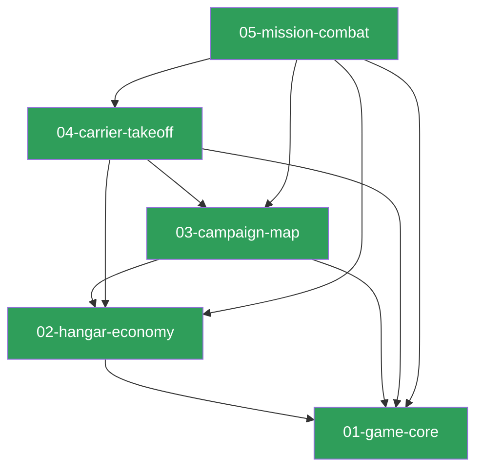

# MDD Connections

## Path Tree

```
Game
├── Campaign   03-campaign-map     complete
├── Engine     01-game-core        complete
├── Hangar     02-hangar-economy   complete
├── Mission    05-mission-combat   complete
└── Takeoff    04-carrier-takeoff  complete
Meta
└── Schema     00-frontmatter-spec complete
```

## Dependency Graph



## Source File Overlap

(none — every source file belongs to exactly one feature doc)

## Warnings

(none)
